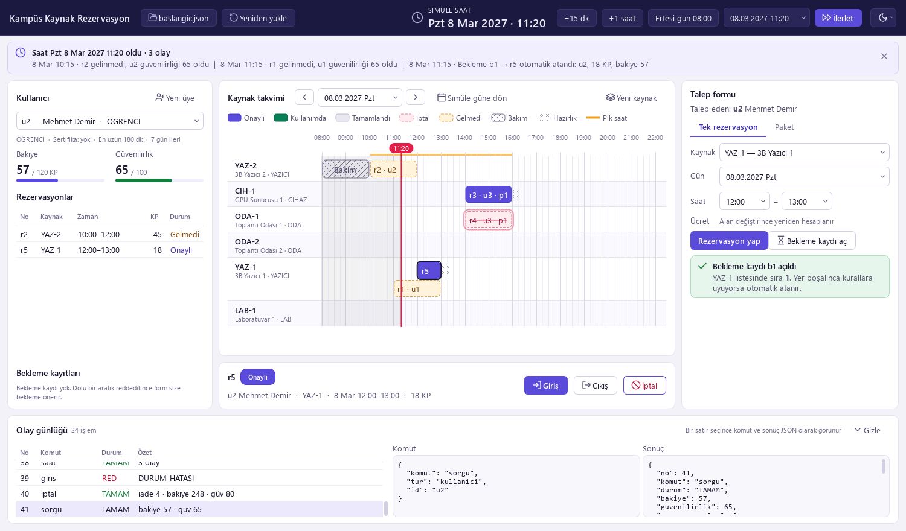
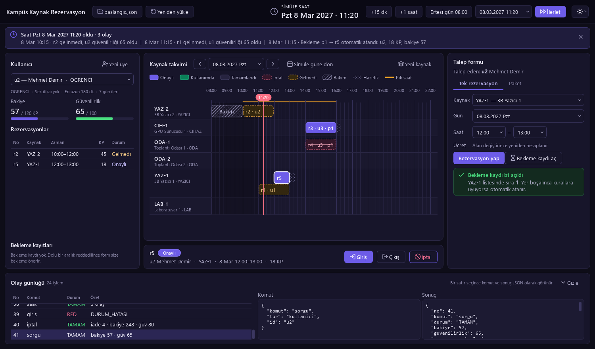
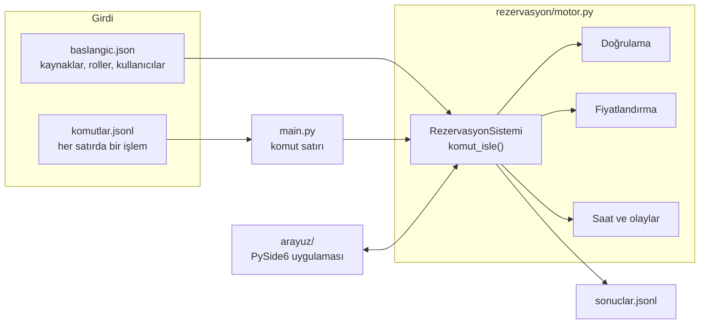
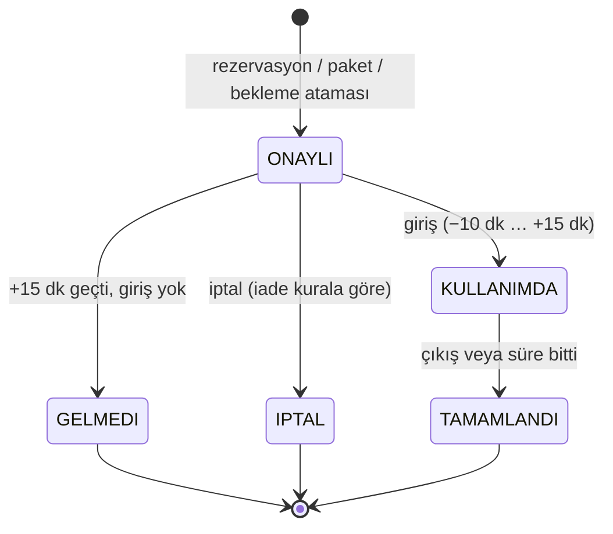

<div align="center">

# Kampüs Kaynak Rezervasyon Sistemi

**Campus Resource Booking System**

Üniversite kampüsündeki ortak kaynaklar (3B yazıcılar, GPU sunucuları, toplantı odaları, laboratuvarlar)
için kural tabanlı rezervasyon motoru ve masaüstü uygulaması.


[Türkçe](#türkçe) · [English](#english)



</div>

---

## Türkçe

### Proje hakkında

Kocaeli Üniversitesi **Yazılım Laboratuvarı I** dersi (2026-2027 Güz) Proje I kapsamında geliştirildi.

Kullanıcılar kampüsteki kaynakları 15 dakikalık dilimlerle rezerve eder. Her kullanıcının haftalık
bir **kredi puanı (KP) bakiyesi** ve 0-100 arası bir **güvenilirlik puanı** vardır. Rezervasyona
gelmeyen ya da son anda iptal eden kullanıcının güvenilirliği düşer; düşük güvenilirlik ise ileri
tarihli rezervasyonu ve paket rezervasyonu kısıtlar.

Proje iki parçadan oluşur:

1. **Rezervasyon motoru** (`rezervasyon/`): Bütün kuralları uygulayan, arayüzden tamamen bağımsız
   modül. Yalnızca Python'un standart kütüphanesini kullanır.
2. **Masaüstü uygulaması** (`arayuz/`): Motoru kullanan PySide6 arayüzü. Kendi içinde hiçbir iş
   kuralı barındırmaz; her işlemi motora komut olarak gönderir.

### Ekran görüntüleri

| Açık tema | Koyu tema |
|---|---|
|  |  |

### Özellikler

**Rezervasyon kuralları**
- 08:00-22:00 çalışma saatleri, 15 dakikalık zaman adımı, en az 30 dakika süre
- Role göre en uzun süre ve en fazla kaç gün ileriye rezervasyon yapılabileceği
- Kaynak türüne göre sertifika şartı (örneğin laboratuvar ve GPU sunucusu için)
- Bakım pencereleri, çakışma kontrolü ve kullanımlar arasında hazırlık süresi
- Aynı kişinin aynı kaynağı art arda kullanması için en az 60 dakika ara
- **Dinamik fiyat:** enerji yoğun kaynaklarda (yazıcı, GPU) 10:00-16:00 arası ×1,5 pik saat
  çarpanı; ayrıca iki saatlik bantta aynı türün doluluğu her %25 arttıkça ücret %25 artar
- **Paket rezervasyon:** 2-4 kalem tek seferde; ya hepsi alınır ya hiçbiri
- **İptal ve iade:** 24 saatten önce tam, 2-24 saat arası yarım iade; 2 saatten az kala iade
  yok ve güvenilirlik düşer
- **Giriş / çıkış:** başlangıçtan 10 dk önce ile 15 dk sonrası arasında giriş; gelinmezse
  rezervasyon otomatik olarak `GELMEDI` olur ve güvenilirlik düşer
- **Bekleme listesi:** dolu bir aralık için sıraya girilir, yer açılınca kurallara uyan ilk
  kişiye otomatik atanır
- **Simüle saat:** saat ilerletildiğinde gelmeme, tamamlanma, bekleme ataması ve haftalık
  bakiye sıfırlaması doğru sırayla işlenir
- Her ret için anlamlı bir hata kodu (`KESISME`, `BAKIYE_YETERSIZ`, `SERTIFIKA_YOK` ...)

**Masaüstü uygulaması**
- Kaynak takvimi: rezervasyon oluşturmak için takvimde sürükleyip bırakmak yeterli
- Durumlar renk ve desenle ayrılır (onaylı, kullanımda, gelmedi, bakım, hazırlık, pik saat)
- Talep formu: tek rezervasyon, paket ve bekleme kaydı; ücret alan değiştikçe yeniden hesaplanır
- Kullanıcı paneli: bakiye, güvenilirlik, rezervasyonlar ve bekleme kayıtları
- Olay günlüğü: yapılan her işlemin komutu ve sonucu JSON olarak görülebilir
- Açık / koyu tema ve isteğe bağlı animasyonlar (seçim bir sonraki açılışta hatırlanır)

### Mimari



Komut satırı ve masaüstü uygulaması aynı `RezervasyonSistemi` sınıfını kullanır. Bu sayede
arayüzde yapılan her işlem, komut satırında aynı komutla birebir aynı sonucu verir.

### Rezervasyonun yaşam döngüsü



### Kullanılan teknolojiler

| Araç | Ne için |
|---|---|
| **Python 3.11+** | Bütün proje |
| `dataclasses`, `datetime`, `fractions`, `json` | Motor; ücret hesabında yuvarlama hatası olmasın diye `Fraction` |
| **PySide6 (Qt 6)** | Masaüstü arayüzü, takvimin özel çizimi, animasyonlar |
| `QtTest` | Arayüzün pencere açmadan otomatik test edilmesi |
| JSON / JSON Lines | Başlangıç verisi, komutlar ve sonuçlar |

### Kurulum

```bash
git clone https://github.com/CanliEnes/campus-resource-booking.git
cd campus-resource-booking
python -m pip install -r requirements.txt
```

> Komut satırı sürümü için kurulum gerekmez; PySide6 yalnızca masaüstü uygulaması için lazım.

### Çalıştırma

**Komut satırı:** başlangıç dosyasını ve komutları okur, sonuçları yazar.

```bash
calistir.bat baslangic.json komutlar.jsonl > sonuclar.jsonl     # Windows
./calistir.sh baslangic.json komutlar.jsonl > sonuclar.jsonl    # Linux / macOS
```

Örnek girdi ve çıktı:

```jsonc
// komutlar.jsonl
{"komut":"kullanici_ekle","id":"u1","ad":"Ayşe Kaya","rol":"OGRENCI","sertifikalar":[],"bakiye":120,"guvenilirlik":80}
{"komut":"kaynak_ekle","id":"YAZ-1","ad":"3B Yazıcı 1","tur":"YAZICI","izinli_roller":["OGRENCI"]}

// sonuclar.jsonl
{"no":1,"komut":"kullanici_ekle","durum":"TAMAM"}
{"no":2,"komut":"kaynak_ekle","durum":"TAMAM"}
```

Desteklenen komutlar: `rezervasyon`, `fiyat`, `paket`, `iptal`, `giris`, `cikis`, `bekleme`,
`sorgu`, `saat`, `kullanici_ekle`, `kaynak_ekle`.

**Masaüstü uygulaması:**

```bash
arayuz.bat                                  # açılışta başlangıç dosyası seçilir
python uygulama.py ornek/baslangic.json     # doğrudan örnek veriyle
```

### Testler

```bash
python testler/karsilastir.py      # tüm senaryoları çalıştırır, beklenen sonuçla alan alan karşılaştırır
python testler/arayuz_testi.py     # örnek senaryonun 19 adımını arayüzdeki düğmelerle yapar
```

`python testler/arayuz_testi.py docs/gorseller` komutu README'deki ekran görüntülerini de yeniden üretir.

| Senaryo | Satır | Ne sınıyor |
|---|---|---|
| `ornek` | 19 | Ödevle verilen örnek senaryo |
| `01_dogrulama_sirasi` | 40 | 13 doğrulama kodunun sırası, sınır değerler (22:00 bitiş, ileri tarih sınırı, 0,5'te yukarı yuvarlama) |
| `02_paket_iptal_bekleme` | 32 | Paket hata sırası, iade dilimleri, bekleme sırası, otomatik atama, haftalık sıfırlama ve kota tavanı |
| `03_saat_doluluk_durum` | 41 | Giriş penceresi, olay anında saat, doluluğa göre fiyat, güvenilirlik 0-100 sınırı |

### Klasör yapısı

```
├── rezervasyon/
│   ├── motor.py          Bütün kurallar, arayüzden bağımsız
│   └── mesajlar.py       Hata kodlarının Türkçe açıklamaları
├── arayuz/
│   ├── ana_pencere.py    Ana pencere ve yerleşim
│   ├── takvim.py         Sürükle-bırak kaynak takvimi
│   ├── paneller.py       Kullanıcı paneli, talep formu, olay günlüğü
│   ├── oturum.py         Arayüz ile motor arasındaki köprü
│   ├── tema.py, stil.py  Renk paleti, açık/koyu tema, ikonlar
├── main.py               Komut satırı girişi
├── uygulama.py           Masaüstü uygulamasını başlatır
├── ornek/                Örnek senaryo
└── testler/              Test senaryoları ve test betikleri
```

---

## English

### About

Developed for the **Software Laboratory I** course (Fall 2026-2027) at Kocaeli University, Project I.

Users book shared campus resources (3D printers, GPU servers, meeting rooms, labs) in 15-minute
slots. Each user has a weekly **credit point (KP) balance** and a **reliability score** from 0 to 100.
No-shows and late cancellations lower reliability, and low reliability restricts advance and
bundle bookings.

The project has two parts:

1. **Booking engine** (`rezervasyon/`): Implements every rule and is fully independent of the UI.
   Uses only the Python standard library.
2. **Desktop app** (`arayuz/`): A PySide6 interface on top of the engine. It holds no business
   logic of its own; every action is sent to the engine as a command.

> The code, identifiers and messages are in Turkish, as required by the course.

### Screenshots

| Light theme | Dark theme |
|---|---|
|  |  |

### Features

**Booking rules**
- Opening hours 08:00-22:00, 15-minute time step, 30-minute minimum duration
- Role-based maximum duration and booking horizon (how many days ahead)
- Certificate requirements per resource type (e.g. labs and GPU servers)
- Maintenance windows, overlap checks and setup time between bookings
- At least 60 minutes between back-to-back bookings of the same resource by the same person
- **Dynamic pricing:** ×1.5 peak-hour multiplier (10:00-16:00) for energy-intensive resources
  (printers, GPUs), plus a 25% surcharge for every 25% of occupancy in each two-hour band
- **Bundle booking:** 2-4 items at once, all or nothing
- **Cancellation and refunds:** full refund more than 24 h ahead, half refund between 2 and 24 h;
  no refund and a reliability penalty under 2 h
- **Check-in / check-out:** check-in from 10 min before to 15 min after start; otherwise the booking
  becomes `GELMEDI` (no-show) automatically and reliability drops
- **Waitlist:** queue for a taken slot; when it frees up it is assigned automatically to the first
  eligible user
- **Simulated clock:** advancing time processes no-shows, completions, waitlist assignments and the
  weekly balance reset in the correct order
- A meaningful error code for every rejection (`KESISME` overlap, `BAKIYE_YETERSIZ` insufficient
  balance, `SERTIFIKA_YOK` missing certificate ...)

**Desktop app**
- Resource calendar: drag across the timeline to create a booking
- Booking states are shown with colors and patterns (approved, in use, no-show, maintenance, setup, peak)
- Request form for single bookings, bundles and waitlist entries, with live price preview
- User panel: balance, reliability, bookings and waitlist entries
- Event log: inspect the JSON command and result of every action
- Light / dark theme and optional animations (remembered between sessions)

### Architecture

See the diagrams in the [Turkish section](#mimari): the command-line tool and the desktop app share the
same `RezervasyonSistemi` class, so any action in the UI gives exactly the same result as the
equivalent command on the command line.

| Turkish | English |
|---|---|
| `ONAYLI` | Approved |
| `KULLANIMDA` | In use |
| `TAMAMLANDI` | Completed |
| `GELMEDI` | No-show |
| `IPTAL` | Cancelled |

### Tech stack

| Tool | Used for |
|---|---|
| **Python 3.11+** | The whole project |
| `dataclasses`, `datetime`, `fractions`, `json` | Engine; `Fraction` keeps pricing free of rounding errors |
| **PySide6 (Qt 6)** | Desktop UI, custom-painted calendar, animations |
| `QtTest` | Headless automated UI tests |
| JSON / JSON Lines | Initial data, commands and results |

### Installation

```bash
git clone https://github.com/CanliEnes/campus-resource-booking.git
cd campus-resource-booking
python -m pip install -r requirements.txt
```

> The command-line version needs no installation; PySide6 is only required for the desktop app.

### Usage

**Command line:** reads the initial state and commands, writes one result per command.

```bash
calistir.bat baslangic.json komutlar.jsonl > sonuclar.jsonl     # Windows
./calistir.sh baslangic.json komutlar.jsonl > sonuclar.jsonl    # Linux / macOS
```

Supported commands: `rezervasyon` (book), `fiyat` (price quote), `paket` (bundle), `iptal` (cancel),
`giris` (check-in), `cikis` (check-out), `bekleme` (waitlist), `sorgu` (query), `saat` (advance clock),
`kullanici_ekle` (add user), `kaynak_ekle` (add resource).

**Desktop app:**

```bash
arayuz.bat                                  # pick an initial-state file on startup
python uygulama.py ornek/baslangic.json     # start directly with the sample data
```

### Tests

```bash
python testler/karsilastir.py      # runs every scenario and compares each result field by field
python testler/arayuz_testi.py     # replays the 19-step sample scenario through the UI buttons
```

Four scenarios with 132 command lines in total cover the validation order, bundles, refunds,
the waitlist, the simulated clock, occupancy pricing and boundary values. All of them pass.
