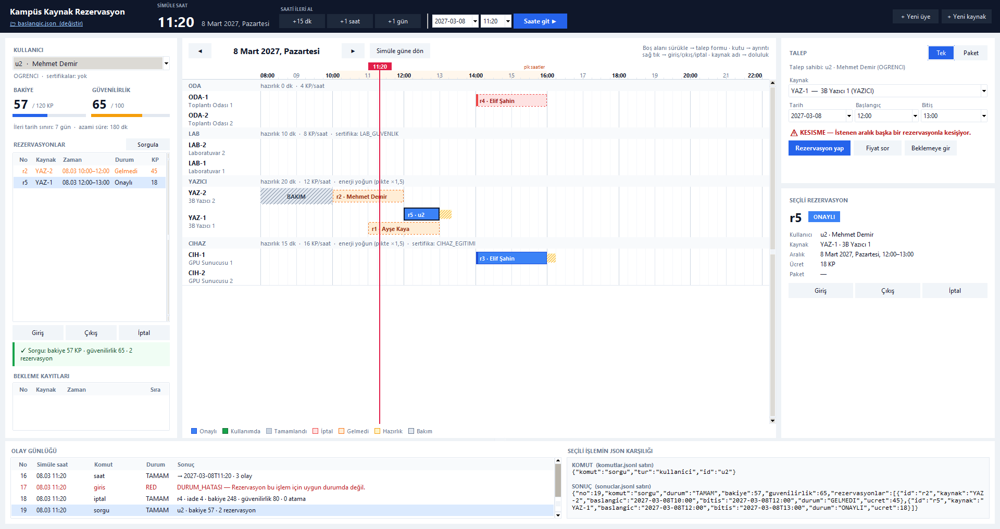
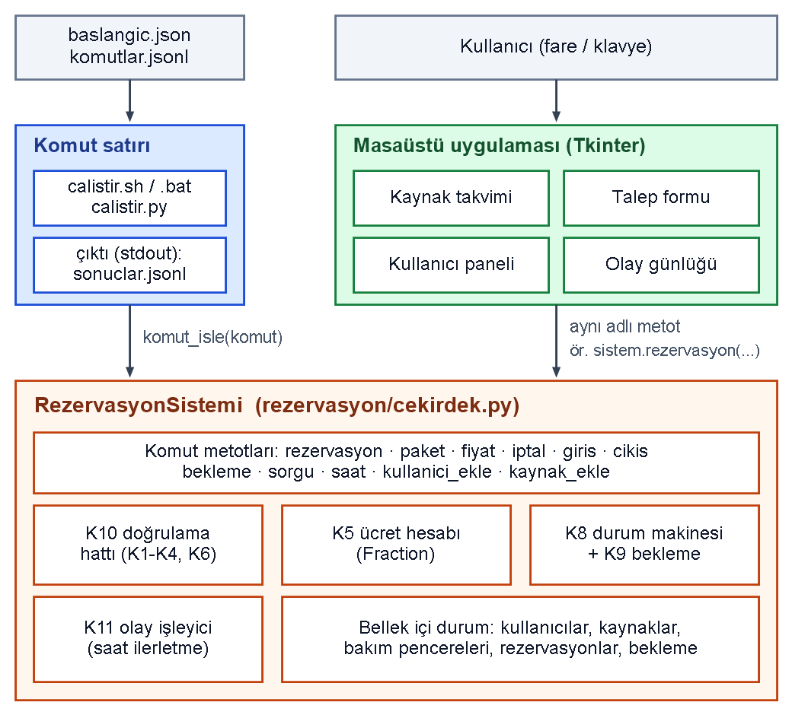
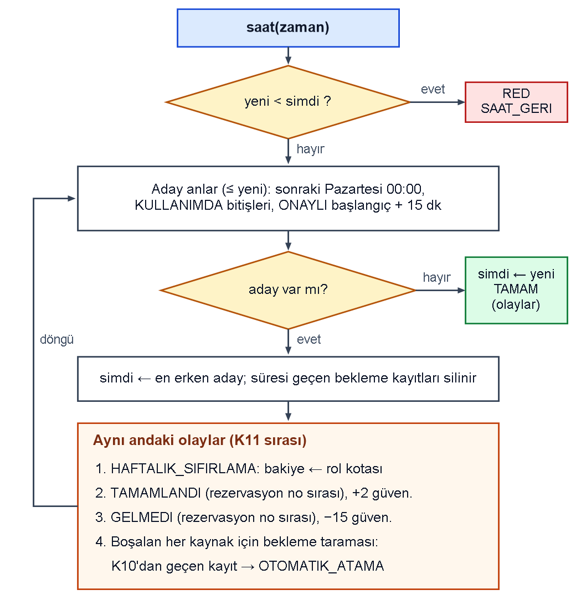

# Kampüs Kaynak Rezervasyon Sistemi

Toplantı odası, laboratuvar, 3B yazıcı ve GPU sunucusu gibi ortak kaynakların paylaşımını
kural tabanlı olarak yöneten bir **rezervasyon motoru** ve bu motoru doğrudan kullanan bir
**masaüstü uygulaması**.

> **EN —** A rule-based campus resource booking engine (dynamic pricing, preparation times,
> reliability score, package bookings, waitlist, event-driven simulated clock) with a Tkinter
> desktop app on top of it. Pure Python standard library, no dependencies.



- **Dil:** Python 3.11+ — yalnızca standart kütüphane, ek paket kurulumu gerekmez
- **Arayüz:** Tkinter
- **Veri:** bellekte tutulur; başlangıç dosyası okunur, değiştirilmez
- **Testler:** 7 senaryo, 227 komut + arayüz üzerinden uçtan uca senaryo testi

Geliştirenler: Enes Canlı, Halit Bulut

## Öne çıkanlar

- **Arayüzden bağımsız motor.** Komut satırı ve masaüstü uygulaması aynı `RezervasyonSistemi`
  sınıfını çağırır; arayüzde hiçbir iş kuralı yoktur.
- **Dinamik fiyatlandırma.** Ücret 15 dakikalık dilimler üzerinden, iki saatlik bantların
  doluluğuna ve enerji yoğun cihazlar için pik saate göre hesaplanır. Hesaplar
  `fractions.Fraction` ile yapılır, kayan nokta hatası olmaz.
- **Olay güdümlü simüle saat.** Saat ilerletildiğinde haftalık kota yenileme, tamamlanma,
  gelmeme ve bekleme listesinden otomatik atama olayları doğru sırayla işlenir.
- **Kurallar veriden okunur.** Kaynak türleri, roller, kotalar, hazırlık süreleri ve
  sertifikalar başlangıç dosyasından gelir; parametre değiştiğinde kod değişmeden yeni kurala
  göre davranır.

## Çalıştırma

### Komut satırı

```bash
./calistir.sh baslangic.json komutlar.jsonl > sonuclar.jsonl
```

```bat
calistir.bat baslangic.json komutlar.jsonl > sonuclar.jsonl
```

Betikler sırasıyla `python3`, `python3.1x`, `python` ve `py -3` komutlarını dener.
`calistir.sh` önce Python 3.11+ arar, bulamazsa makinedeki Python 3 ile çalışır
(motor 3.9 ve 3.10'da da aynı sonuçları üretir).

### Masaüstü uygulaması

```bash
./arayuz.sh            # Linux / macOS
```

```bat
arayuz.bat             :: Windows (ya da: py -3 masaustu.py)
```

Açılışta başlangıç dosyası seçilir. Dosya yolu argüman olarak da verilebilir:
`py -3 masaustu.py testler/01_ornek_senaryo/baslangic.json`.

### Testler

```bash
python testler/testleri_calistir.py          # tüm komut dosyası senaryoları
python testler/arayuz_senaryo_testi.py       # örnek senaryoyu arayüz üzerinden yapar
```

Sonuçlar beklenen satırlarla alan alan karşılaştırılır: fazladan alan hata sayılmaz, eksik
veya farklı alan hata sayılır.

## Dosya biçimleri

Başlangıç dosyası (`baslangic.json`): `saat`, `kaynak_turleri`, `roller`, `kaynaklar`,
`bakim_pencereleri`, `kullanicilar`. Komut dosyası JSON Lines biçimindedir; her satır bir komut,
her komut için bir sonuç satırı üretilir:

```json
{"komut":"rezervasyon","kullanici":"u1","kaynak":"YAZ-1","baslangic":"2027-03-08T11:00","bitis":"2027-03-08T13:00"}
{"no":5,"komut":"rezervasyon","durum":"TAMAM","rezervasyon_id":"r1","ucret":36,"bakiye":84}
```

Komutlar: `saat`, `rezervasyon`, `paket`, `fiyat`, `iptal`, `giris`, `cikis`, `bekleme`,
`sorgu`, `kullanici_ekle`, `kaynak_ekle`.

## Kurallar (K1–K11)

Koddaki `K1`…`K11` yorumları bu listeye karşılık gelir.

| Kod | Kural |
|---|---|
| K1 | Temel kontroller: 15 dk adım, 08:00–22:00 ve aynı gün, en az 30 dk / en fazla rolün azami süresi, ileri tarih sınırı, rol izni, sertifika |
| K2 | Bakım pencereleriyle kesişme yasak; bakımdan sonra hazırlık süresi aranmaz |
| K3 | Aynı kaynakta kesişme (`KESISME`) ve türe özgü hazırlık süresi (`HAZIRLIK_IHLALI`) |
| K4 | Aynı kullanıcı, aynı kaynakta ardışık iki rezervasyon arasında en az 60 dk |
| K5 | Ücret: dilim × temel ücret × bant çarpanı (`1 + 0,25 × ⌊4 × doluluk⌋`) × pik çarpanı (×1,5) |
| K6 | Haftalık kota: her Pazartesi 00:00'da bakiye rol kotasına eşitlenir, iade kotayı aşamaz |
| K7 | Paket: 2–4 kalem, ya hepsi ya hiçbiri |
| K8 | Durum makinesi: ONAYLI → KULLANIMDA → TAMAMLANDI, GELMEDI, IPTAL; iade tablosu ve güvenilirlik puanı |
| K9 | Bekleme listesi: yer boşalınca güvenilirlik → kayıt saati → numara sırasıyla otomatik atama |
| K10 | Doğrulama sırası: ilk başarısız kontrolün hata kodu döner |
| K11 | Saat ilerletme: sıfırlama → TAMAMLANDI → GELMEDI → bekleme taraması |

## Klasör yapısı

| Yol | İçerik |
|---|---|
| `rezervasyon/cekirdek.py` | Motor: veri modeli, K1–K11 kuralları, tüm komutlar |
| `calistir.py`, `calistir.sh`, `calistir.bat` | Komut satırı girişi (JSONL okur, JSONL yazar) |
| `masaustu.py`, `arayuz.sh`, `arayuz.bat` | Masaüstü uygulamasının girişi |
| `arayuz/uygulama.py` | Ana pencere: kullanıcı paneli, talep formu, seçim kartı, saat, günlük |
| `arayuz/takvim.py` | Kaynak takvimi (Canvas çizimi, sürükle-seç, alt şeritler) |
| `arayuz/diyaloglar.py` | Yeni üye / yeni kaynak pencereleri |
| `arayuz/tema.py` | Renkler, yazı tipleri, hata kodlarının Türkçe açıklamaları |
| `testler/` | 7 senaryo / 227 komut (`baslangic.json`, `komutlar.jsonl`, `beklenen.jsonl`) ve test betikleri |
| `docs/` | Ekran görüntüsü ve diyagramlar |

## Mimari



- Her komut `RezervasyonSistemi` içinde **aynı adlı bir metotla** karşılanır.
  `komut_isle()` JSON satırını bu metoda yönlendirir.
- Arayüz aynı metotları çağırır (`Uygulama.calistir`) ve sonucu olduğu gibi gösterir; geçersiz
  talepler de motora gönderilir, reddi ve kodunu motor verir.
- Kodda sabit olan değerler yalnızca kuralların kendisidir (15 dk adım, 08:00–22:00,
  10:00–16:00 pik, ×1,5, 60 dk ardışık boşluk, iade tablosu vb.).

### Kuralların uygulanışı

- **Doğrulama (K10)** `_kurallari_denetle()` içinde sırayla yapılır; ilk başarısız adımın kodu
  döner. `fiyat`, `paket` kalemleri ve `bekleme` aynı fonksiyonu bakiye kontrolü kapalı olarak
  kullanır.
- **Ücret (K5)** kesirli sayılarla hesaplanır. Bant çarpanı tam sayı aritmetiğiyle bulunur,
  toplam 0,5 yukarı yuvarlanır.
- **Saat (K11)** ilerletmede bir sonraki olay anı (Pazartesi 00:00, `KULLANIMDA` bitişi,
  `ONAYLI` başlangıç + 15 dk) bulunur, o ana gidilir ve olaylar sırayla işlenir. Otomatik
  atamayla oluşan yeni rezervasyonların sonraki olayları da aynı döngüde yakalanır.



## Arayüz — tasarım kararları

- **Tek ekran:** kullanıcı paneli (sol), takvim (orta), talep formu + seçim kartı (sağ),
  olay günlüğü (alt). Hiçbir işlem için pencere değiştirmek gerekmez; yalnızca üye/kaynak
  ekleme küçük bir diyalog açar.
- **Takvimden talep:** boş alana tıklamak 1 saatlik, sürüklemek seçilen aralık için formu
  doldurur (paket modunda sıradaki kaleme yazar). Saatler 15 dakikaya oturtulur.
- **Ücret önizlemesi:** form her değiştiğinde motorun `fiyat` metodu sessizce çağrılır
  (durum değişmez); geçersizse kod ve açıklaması anında görünür.
- **Bekleme kısayolu:** talep `KESISME` veya `HAZIRLIK_IHLALI` ile reddedilirse sonuç kutusunda
  "Bu talep için bekleme kaydı aç" düğmesi çıkar; bilgiler yeniden girilmez.
- **Geri bildirim işlemin yanında:** talep sonucu formun altında, giriş/çıkış/iptal sonucu
  düğmenin altında, saat olayları saat denetiminin altında gösterilir.
- **Takvim okunabilirliği:** durum renkleri (onaylı mavi, kullanımda yeşil, tamamlandı gri,
  iptal kırmızı kesikli, gelmedi turuncu kesikli), bakım koyu taralı, hazırlık sarı taralı.
  IPTAL/GELMEDI bir kutuyla çakışan yeni rezervasyon aynı satırda ayrı alt şeride iner.
  Paket rezervasyonların sol kenarında koyu bir şerit vardır. Kaynaklar türe göre gruplanır ve
  grup başlığında türün kuralları (hazırlık, ücret, enerji yoğunluğu, sertifika) yazar.
- **Değer seçimi:** kullanıcı, kaynak, tarih, saat, rol, tür, sertifika ve izinli roller
  listeden seçilir; yeni üye bakiyesi rol kotasıyla, yeni kaynak kimliği türün sonraki
  numarasıyla önerilir.

## Uç durumlarda verilen kararlar

1. Bilinmeyen komut `BILINMEYEN_KOMUT`; `saat` komutunda veya `sorgu kaynak` gününde
   okunamayan tarih ve tanımsız sorgu türü `GECERSIZ_DEGER` döner.
2. Paket için kullanıcı bulunamazsa `kalemler: []` alanı da eklenir.
3. Erken çıkışta rezervasyonun bitişi, çıkış anındaki simüle saat olur.
4. `bekleme` yanıtındaki `sira`, K9 öncelik sırasına göre o kaynağın listesindeki konumdur.
5. Başlangıcı geçmişte kalan bekleme kayıtları saat her ilerlediğinde sessizce silinir.
6. Paket içi kontrolde aynı kaynaktaki iki kalem arasında `max(hazırlık, 60 dk)` boşluk aranır;
   bu tek koşul kesişmeyi, hazırlık ihlalini ve ardışık kullanımı birlikte kapsar.
